<div align="center">


# Kiorex Passport (`kiorex-account`)

**One sign-in for the whole Kiorex ecosystem.** Phone OTP, passkeys, family accounts, organisations and back-channel logout, with no clinical data in identity.


-0369A1)


[Quick start](#quick-start) · [Architecture](#architecture) · [Sign-in flow](#sign-in-flow) · [Screens](#screens) · [Docs](#where-to-read-next) · [Ecosystem map](https://github.com/mshall/kiorex-workspace)

</div>

> **Synthetic data only.** Seed users, OTP and reset steps: [Docs/TEST_DATA.md](Docs/TEST_DATA.md) (DEV ONLY). The dev IdP **refuses to start when `NODE_ENV=production`**.
> **Demo data for manual testing** (personas, counts, click-path test scripts, role checklists): [DEMO_DATA.md](DEMO_DATA.md) (DEV ONLY).

---

## What and why

Kiorex Passport (user-facing name; host `account.kiorex.com`; technical name `kiorex-account`) is the shared OIDC identity for Kiorex, Kiorly Clinic and the other products (KX-04, ADR-012/013). Patients sign in with a phone number and a one-time code, optionally add a passkey, and manage family, linked accounts, organisations, sessions and their own data from a self-service web UI. Production runs on a **managed IdP** (default Cognito, vendor decision still open: [IDP_SCORECARD](Docs/IDP_SCORECARD.md)), so this repo holds the **config-as-code**, a **local-only dev OIDC provider** that mirrors the contract, the OTP sender and the back-channel logout helpers. There is no custom crypto in production.

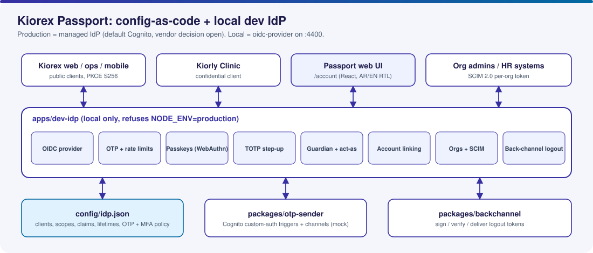

## At a glance

| | |
|---|---|
| **Issuer (dev)** | `http://localhost:4400`; discovery `/.well-known/openid-configuration`; JWKS `/jwks` |
| **Flow** | Authorization code + PKCE (S256 mandatory), exact redirect URIs |
| **Tokens** | Access JWT RS256, `aud=kiorex-api`, 15 min or less; refresh 30 days, rotating with reuse detection |
| **Claims** | `sub phone_number phone_number_verified name locale kx_roles` (+ `sid`, `acr`, `amr`); never clinical data or addresses |
| **Login** | Phone OTP (WhatsApp, SMS fallback; mocked), passkeys, TOTP for privileged roles |
| **OTP limits** | 5 sends per phone per hour, 20 per IP per hour, 5 attempts then 15 min lockout |
| **Clients** | `kiorex-web`, `kiorex-ops`, `kiorex-mobile`, `kiorly` (staff app; legacy `kiorly-team` kept), `kiorly-home` (Kiorly Home web sign-in, ADR-038) (public); `kiorly-clinic` (confidential); `kiorex-passport-web` (UI) |
| **Messaging** | Mocked: codes and invitations land in the dev inbox (`GET /dev/inbox`) |
| **Standing rule** | No tax-authority anything; no clinical data in identity (ADR-013) |

## Features

| Capability | KA ID | Status |
|---|---|---|
| OIDC code + PKCE, four dev clients | KA-01 | :white_check_mark: |
| Phone OTP with rate limits and lockout | KA-02 | :white_check_mark: dev, :gear: config for prod |
| Passkeys (register and login) and TOTP step-up | KA-03, KA-10 | :white_check_mark: |
| Short access tokens, rotating refresh | KA-04 | :white_check_mark: |
| Session list, remote revoke, back-channel logout | KA-05 | :white_check_mark: |
| Guardian and dependant links, act-as token | KA-06 | :white_check_mark: |
| Account export and deletion, `subject.deleted` | KA-07 | :white_check_mark: |
| Account linking with operator review | KA-08 | :white_check_mark: |
| Organisations, invitations, role hints | KA-09 | :white_check_mark: |
| OIDC federation and SCIM 2.0 | KA-11 | :white_check_mark: dev |
| Tamper-evident auth audit chain | KA-12 | :white_check_mark: dev |
| Self-service web UI (AR/EN, RTL, dark mode) | KA-UI | :white_check_mark: |
| Multi-edition memberships (Clinic and Nurse) | KA-14 | :white_check_mark: |

Full trace with tests per requirement: [Docs/KA_TRACE.md](Docs/KA_TRACE.md).

## Architecture

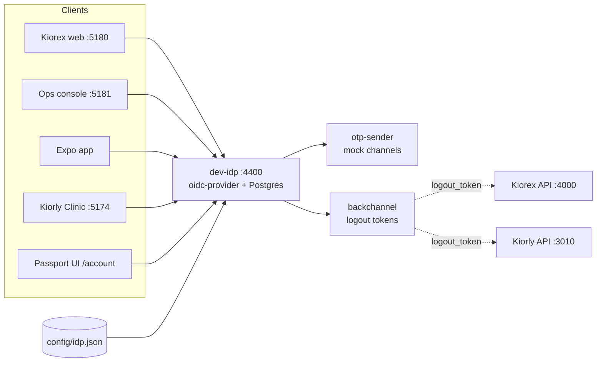

## Sign-in flow

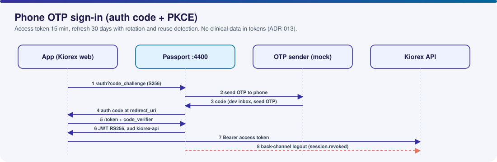

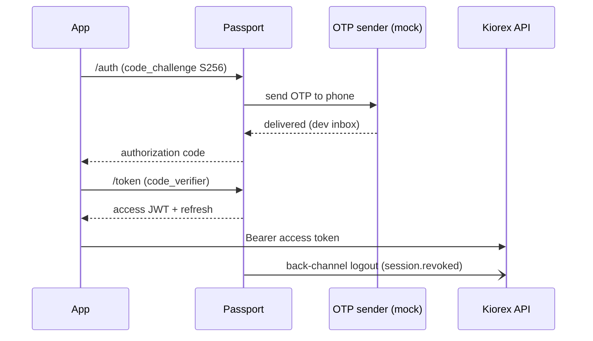

<details>
<summary><b>Guardian, linking and step-up in one picture</b></summary>

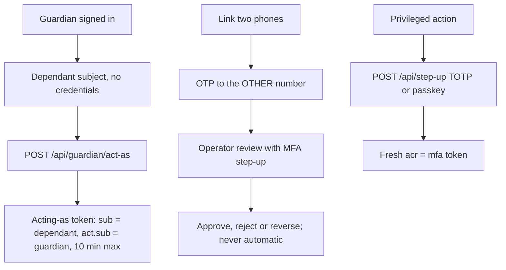
</details>

## Screens

Real captures of the Passport web UI (synthetic data, English light theme, plus one Arabic dark).

| Sign in | Account home | Security |
|---|---|---|
| 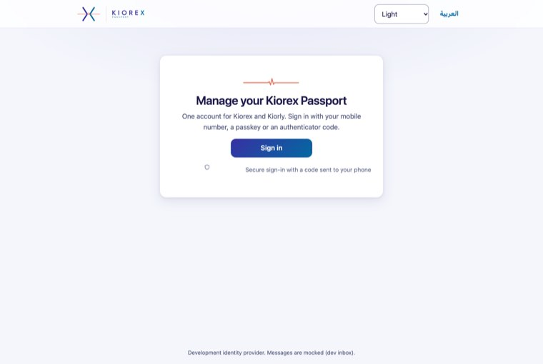 | 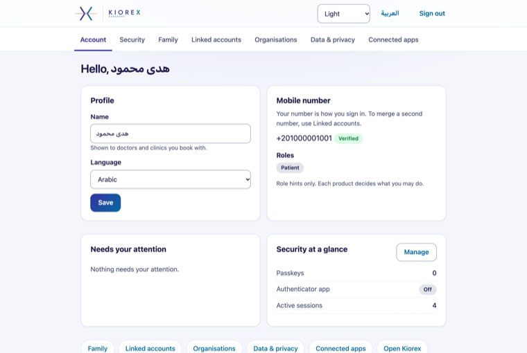 | 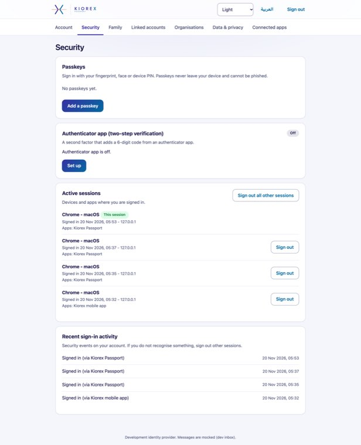 |

| Family and guardians | Data and privacy | Organisations |
|---|---|---|
| 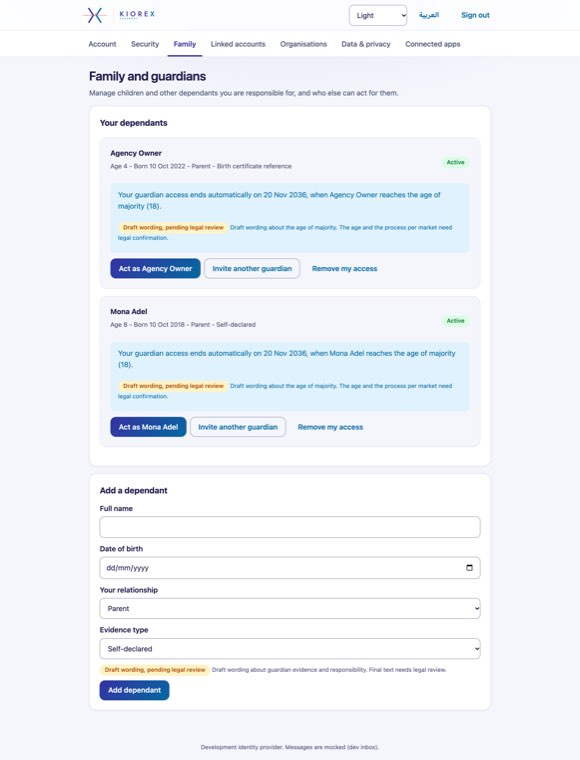 | 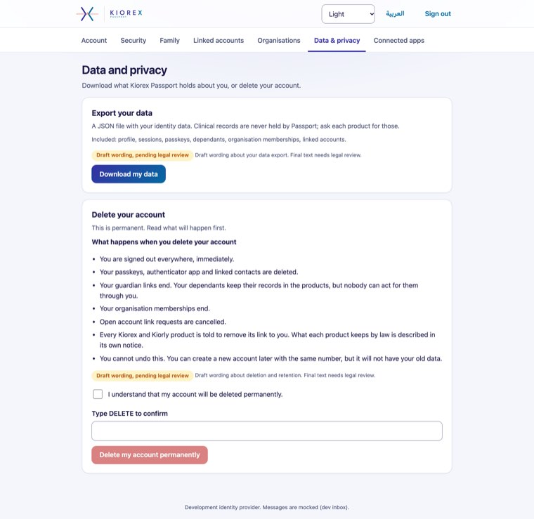 | 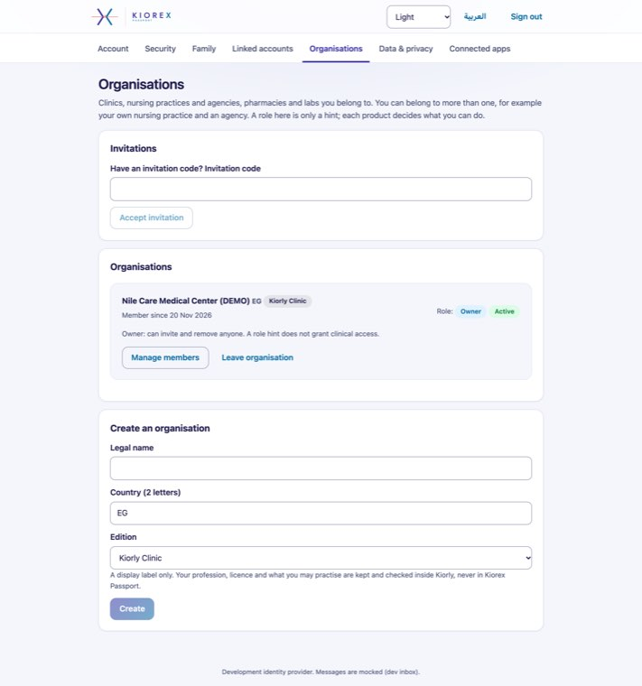 |

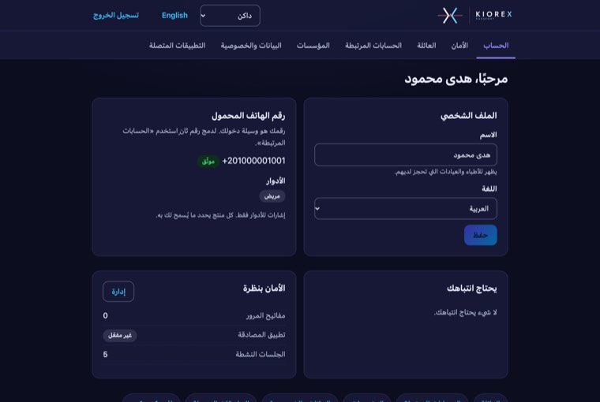

## Kiorly Home (ADR-038)
`apps/kiorly-home` is the one web sign-in for the Kiorly provider products (`https://www.kiorly.com/signin`, local http://localhost:5194/signin): sign in with Passport, then pick a workspace (Clinic, Nurse, Pharmacy, Lab) from `GET /api/workspaces`. Domains for every environment live in `config/domains.json` ([Docs/DOMAINS.md](Docs/DOMAINS.md)); go-live checklist in [Docs/NEEDS_HUMAN.md](Docs/NEEDS_HUMAN.md). See [apps/kiorly-home/README.md](apps/kiorly-home/README.md).

## Quick start

```bash
cd kiorex-account
npm install
npm run dev            # dev IdP at http://localhost:4400 (Postgres 127.0.0.1:5433/kiorex_account)
```

Then open <http://localhost:4400/account>, sign in with a seed number from [Docs/TEST_DATA.md](Docs/TEST_DATA.md), and read the code from the console or `GET /dev/inbox`.

| What | Where |
|---|---|
| Dev IdP | http://localhost:4400 |
| Passport web UI | http://localhost:4400/account |
| Dev inbox (OTP, invitations) | http://localhost:4400/dev/inbox |
| Second fake upstream IdP (federation tests) | http://localhost:4401 |
| Postgres | 127.0.0.1:5433, database `kiorex_account` |

## Tests

```bash
npm test               # unit + end-to-end API tests + UI component tests (jsdom, axe); needs Postgres on 5433, uses a throwaway schema
npm run test:unit      # unit only
npm run typecheck
npm run test:e2e       # Playwright on the SYSTEM Chrome (no download); own IdP on :4450
npm run db:reset       # clear dev sessions, tokens and OTP rate limits
```

## Environment variables

| Variable | Purpose |
|---|---|
| `PORT` | Dev IdP port (default 4400) |
| `ISSUER` | Issuer URL (default `http://localhost:4400`) |
| `DATABASE_URL`, `KX_DB_SCHEMA` | Postgres connection and schema (tests use a throwaway schema) |
| `KX_FLAG_ACCOUNT_PASSKEYS` | `true`/`false`: passkey registration and login |
| `KX_FLAG_ACCOUNT_PROVIDER_SSO` | `true`/`false`: OIDC federation |
| `KX_FAKE_UPSTREAM_PORT` | Fake upstream IdP port (default 4401) |
| `KX_TRUST_PROXY` | Trust `X-Forwarded-*` behind a proxy |
| `NODE_ENV` | `production` makes the dev IdP refuse to start |

## Folder map

```text
kiorex-account/
├── config/
│   ├── idp.json          clients, scopes, claims, lifetimes, OTP and MFA policy (single source of truth)
│   └── seed-users.json   local seed users only (never read by the Cognito stack)
├── apps/
│   ├── dev-idp/          local OIDC provider on oidc-provider, :4400   (apps/dev-idp/README.md)
│   └── passport-ui/      Passport web UI, served at /account           (apps/passport-ui/README.md)
├── packages/
│   ├── otp-sender/       Cognito custom-auth triggers + channels (log, WhatsApp, SMS, fallback)
│   └── backchannel/      build, verify, deliver OIDC back-channel logout tokens
├── infra/tofu/           OpenTofu modules and live stacks             (infra/README.md)
├── Docs/                 INDEX, KA_TRACE, IDP_SCORECARD, SCIM, DEV_IDP_CONTRACT, NEEDS_HUMAN
├── platform/             data-cells.json, waf-rules.json
└── test/                 repo-level guards (no tax authority, demo seed guard)
```

For the OpenTofu/Cognito stack: read `config/idp.json` (environments `staging` and `production`; ignore `environments.local` and the seed users). OTP Lambda handlers are exported from `packages/otp-sender/src/lambda.ts`.

## Deployment overview

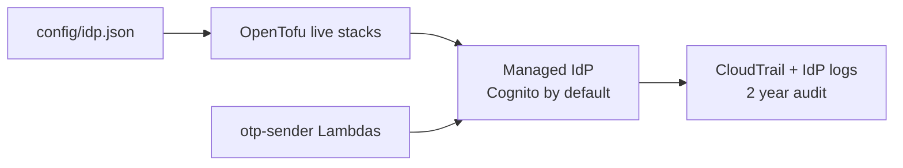

Production IdP vendor is a NEEDS_HUMAN decision. Nothing is deployed and **no AWS deploy happens until the founder says so**; `tofu fmt` and `validate` run locally.

## Security notes

- Dev IdP is local only and refuses `NODE_ENV=production`; production uses a managed IdP.
- No custom crypto in production: `oidc-provider` (certified), `jose`, `@simplewebauthn/server`. `crypto` is used only for CSPRNG codes, salted HMAC of OTPs, constant-time compare and the audit hash chain.
- Tokens carry an allow-list of claims; a test fails on any address, profession, licence or clinical claim.
- Phone numbers never appear raw in the audit chain. Account deletion tombstones and fans out `subject.deleted`.
- Messaging is mocked; real WhatsApp, SMS and e-mail come in the pre-launch provider pass.
- No secrets in git; dev values live in `config/seed-users.json` and the workspace `INTEGRATION.md`, and are blocked in production.

## Where to read next

| Read | For |
|---|---|
| [Docs/INDEX.md](Docs/INDEX.md) | Index of every document here |
| [Docs/DEV_IDP_CONTRACT.md](Docs/DEV_IDP_CONTRACT.md) | Dev IdP contract, session API and all identity endpoints |
| [Docs/KA_TRACE.md](Docs/KA_TRACE.md) | Requirement trace with tests |
| [Docs/IDP_SCORECARD.md](Docs/IDP_SCORECARD.md) | Managed IdP comparison (vendor decision open) |
| [Docs/SCIM.md](Docs/SCIM.md) | SCIM 2.0 provisioning |
| [Docs/NEEDS_HUMAN.md](Docs/NEEDS_HUMAN.md) | Decisions that need a human |
| [Docs/TEST_DATA.md](Docs/TEST_DATA.md) | Synthetic seed users |
| [infra/tofu/README.md](infra/tofu/README.md) | OpenTofu stacks |

## Contributing

Work on `main` through pull requests. Use Conventional Commits with requirement IDs (for example `feat(passport): KA-10 step-up policy`). Run `npm run typecheck && npm test` first. Re-vendor the brand kit when `../_brand` changes and never redraw the logo. Stop and ask a human for legal or clinical wording, age-of-majority rules, vendor choice, production credentials and breaking a published contract.

## Glossary

| Term | Meaning |
|---|---|
| **OIDC / PKCE** | OpenID Connect sign-in with a proof key so public clients are safe |
| **Back-channel logout** | The IdP POSTs a signed logout token to each product when a session ends |
| **Act-as token** | Short token a guardian uses to act for a dependant |
| **Step-up** | Re-prove identity (TOTP or passkey) before a sensitive action; token gets `acr=mfa` |
| **SCIM** | Standard for provisioning users and groups from an organisation's directory |
| **KA-xx** | Requirement IDs from KX-04 |

<div align="center"><sub>Private repository. Part of <a href="https://github.com/mshall/kiorex-workspace">Kiorex v2</a>.</sub></div>
